<div align="center">

<picture>
  <source media="(prefers-color-scheme: dark)" srcset="client/public/logo-light.svg">
  
</picture>

### Rent the latest electronics, hassle-free

[](https://github.com/maksimts-kool/prokat-hub/actions/workflows/ci.yml)
[](LICENSE)


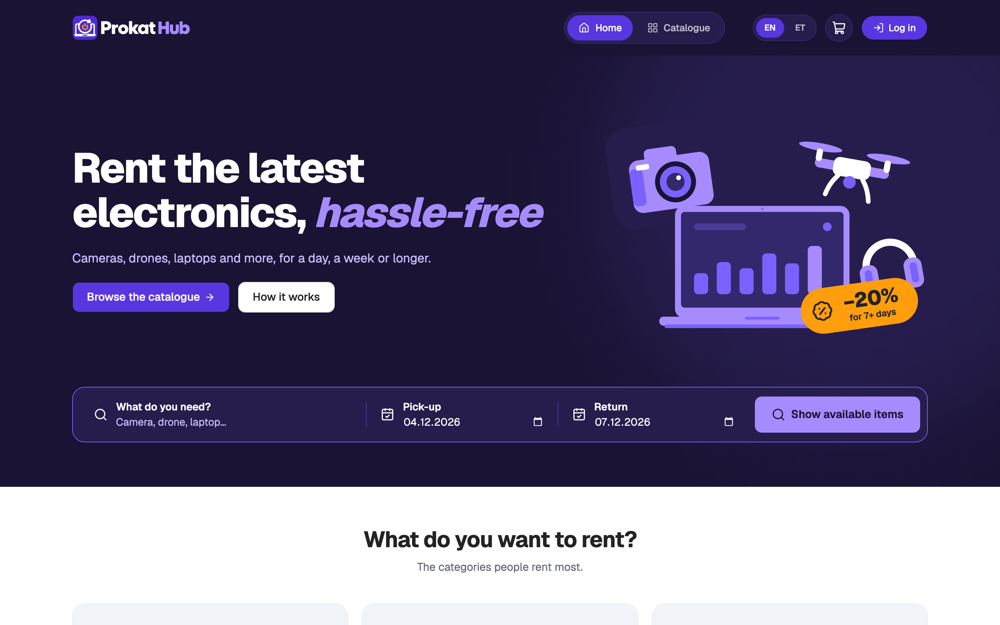

</div>

## 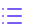Contents

- [Overview](#overview)
- [Features](#features)
- [Screenshots](#screenshots)
- [Tech stack](#tech-stack)
- [Architecture](#architecture)
- [Quick start](#quick-start)
- [Ports and URLs](#ports-and-urls)
- [Demo accounts](#demo-accounts)
- [API](#api)
- [Tests](#tests)
- [Project structure](#project-structure)
- [More details](#more-details)
- [License](#license)

## Overview

**Prokat Hub** ("prokat" means rental) runs the day-to-day work of a shop that rents out electronics.

- **Customers** browse the catalogue without an account, pick their dates, see a price quote with longer-rental discounts and book one or several items at once.
- **Staff** use the rental desk to hand items out, take them back and follow up on overdue rentals.
- **Admins** manage items and categories and see which items earn the most.
- A **background worker** checks every hour for rentals past their end date, marks them overdue and charges the late fees.

The whole system is one responsive React website and an ASP.NET Core Web API, with a MariaDB database and the worker beside them. It all runs in Docker Compose with one command.

## Features

**Catalogue and booking**

- Catalogue of 33 seeded items in 7 categories, with search, category filter, sorting and paging
- Pick-up and return dates filter the catalogue to items that are free for the whole range
- Item page with a photo gallery, specifications, a calendar of booked days and a live price quote
- Longer rentals cost less per day: 10 % off from 3 days, 20 % from 7 days, 30 % from 14 days
- Cart to book several items, each with its own dates, in one go
- Double bookings are impossible: an overlapping booking is rejected with `409 Conflict`
- Live availability over SignalR: when someone books an item, open pages update without a refresh

**Rental desk and admin**

- Rental desk with tabs for today's pickups, items out now, overdue rentals and all rentals
- Status flow `Booked → Issued → Returned`, plus `Cancelled` and `Overdue`, with a history of who changed what
- Late fee for every late day (150 % of the daily price), charged once per day by the worker
- Catalogue management: add, edit and retire items, and manage categories
- Reports: the most rented items by rental count and revenue for any period, as a chart

**Platform**

- Four roles (Customer, Staff, Admin, Service) with JWT authentication and role-based access
- English and Estonian interface, switchable at any time
- Responsive from 375 px phones to desktops; Lighthouse accessibility score 100 on every page ([QA report](docs/qa-responsive-accessibility.md))
- Request validation with FluentValidation and consistent `ProblemDetails` errors
- Structured request logs with Serilog, with a trace id that matches the error response
- Swagger UI and an OpenAPI document; the client's API code is generated from it with Orval
- Database migrations and demo data are applied on start, so a fresh clone works straight away

## Screenshots

### Desktop

| Catalogue | Item and booking |
| --- | --- |
| 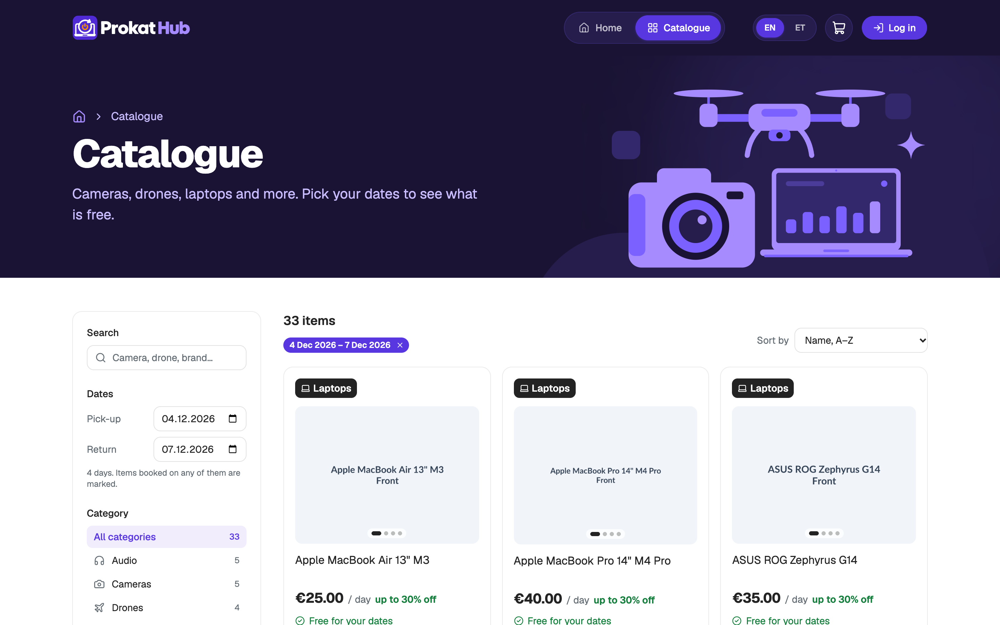 | 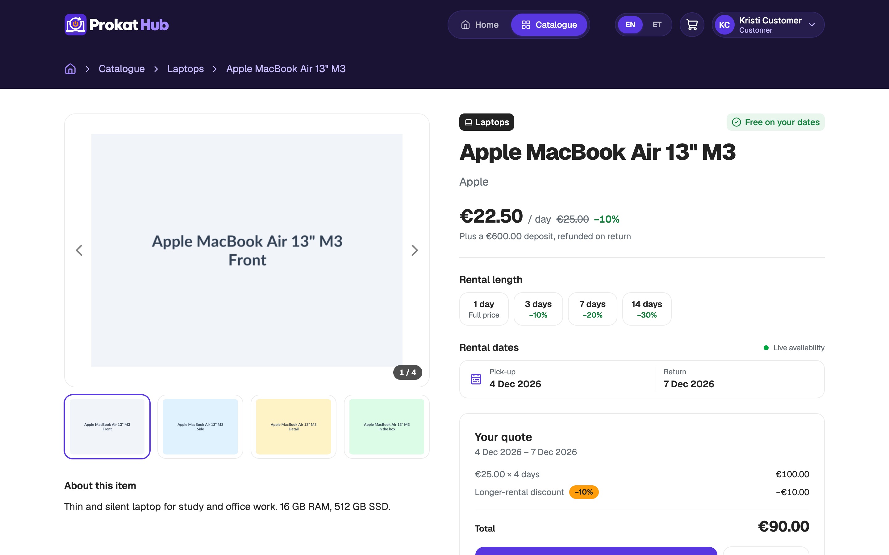 |
| **My rentals** (customer) | **Rental desk** (staff) |
| 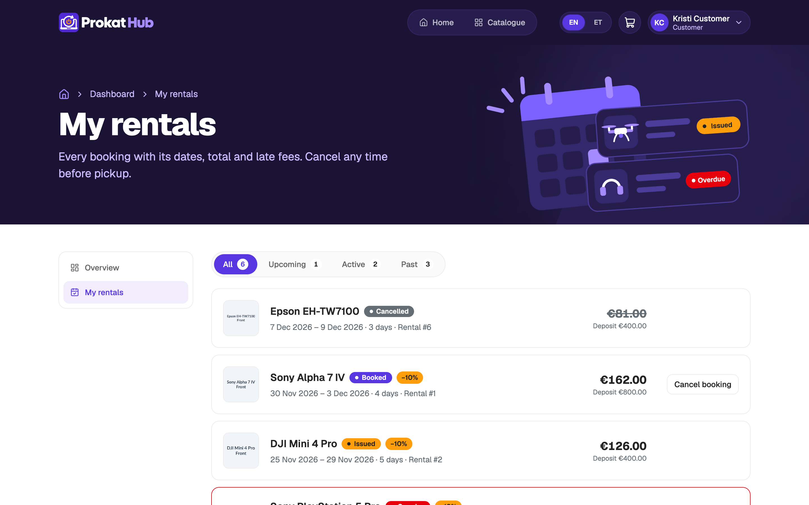 | 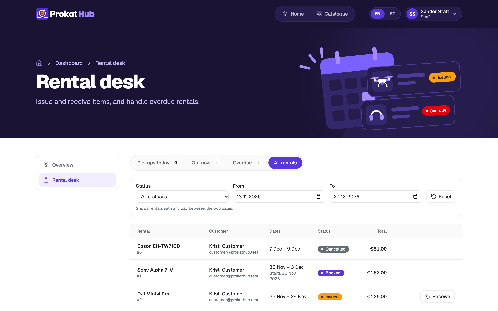 |
| **Catalogue management** (admin) | **Reports** (admin) |
| 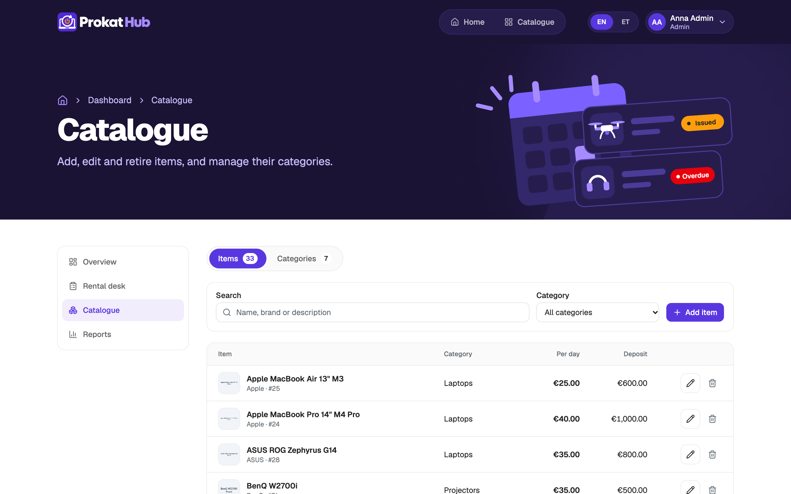 | 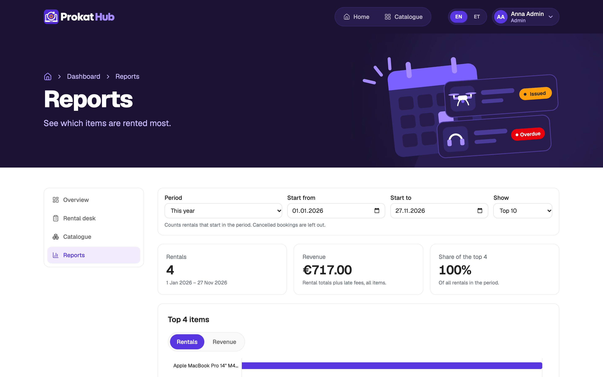 |

### Mobile

| Home | Catalogue | Item | My rentals |
| --- | --- | --- | --- |
| 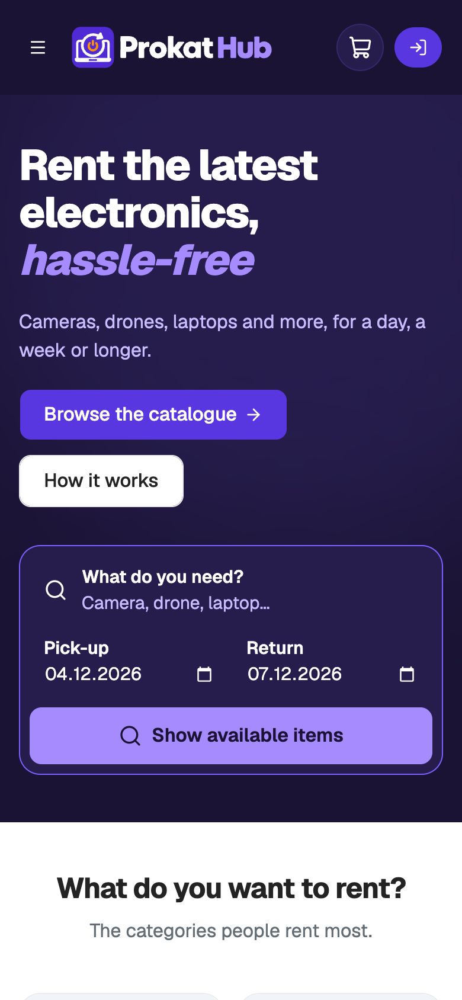 | 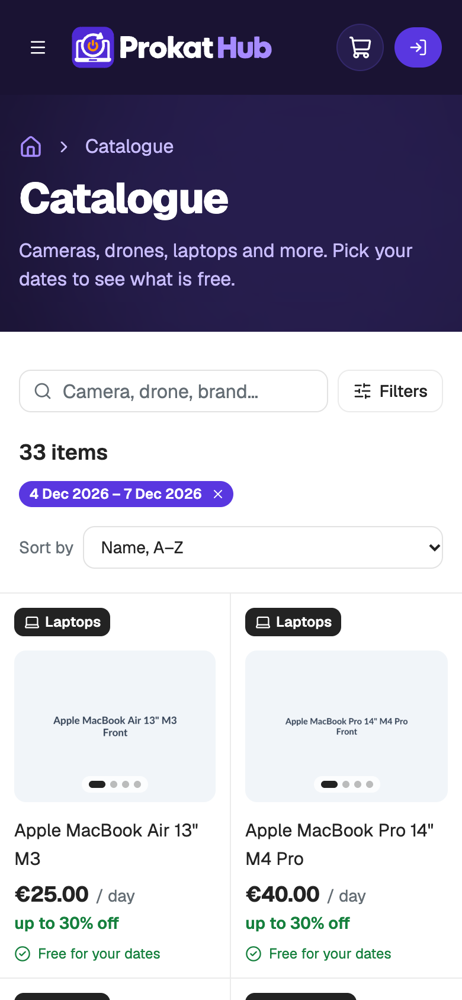 | 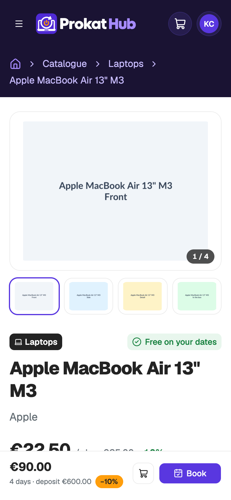 | 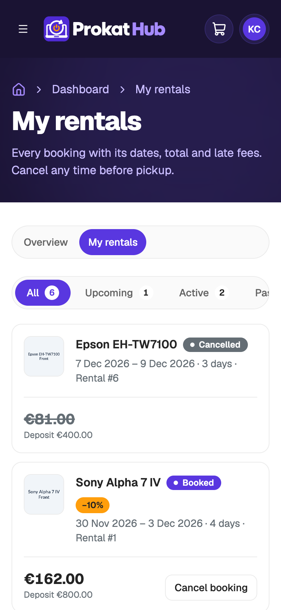 |

## Tech stack

| Part | Technologies |
| --- | --- |
| **Web client** | React 19, TypeScript, Vite, Tailwind CSS 4, shadcn/ui, React Router, TanStack Query, TanStack Table, React Hook Form + Zod, Recharts, i18next, SignalR client, Orval |
| **API** | .NET 10, ASP.NET Core Web API (controllers), EF Core with Pomelo (MariaDB), ASP.NET Core Identity + JWT, FluentValidation, Mapperly, SignalR, Serilog, Swagger UI |
| **Worker** | .NET 10 Worker Service, typed `HttpClient` with Polly resilience (retries, timeouts, circuit breaker) |
| **Database** | MariaDB 11.4 |
| **Tests** | xUnit, NSubstitute (238 tests) |
| **Tooling** | Docker Compose, GitHub Actions, oxlint, Prettier, pnpm |

## Architecture

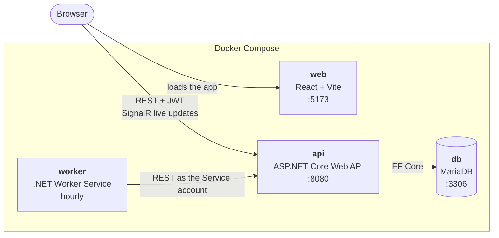

- The **web** container serves the React app. The browser then calls the **API** directly with a JWT in the `Authorization` header.
- The **API** is layered: controllers → services (business rules) → repositories (EF Core) → MariaDB. Validation, mapping and error handling sit beside them.
- The **worker** has no database access. It logs in to the API like any client and calls `GET /api/rentals/overdue` and `POST /api/rentals/{id}/mark-late`.
- A **SignalR hub** pushes `AvailabilityChanged` events to signed-in browsers whenever a booking, cancellation or return changes an item's free days.

The domain model, ER diagram, status flow and pricing rules are in [docs/er-diagram.md](docs/er-diagram.md).

## Quick start

The only thing you need is **[Docker Desktop](https://www.docker.com/products/docker-desktop/)** (or Docker Engine with Compose v2.22+).

**1. Clone the repository**

```bash
git clone https://github.com/maksimts-kool/prokat-hub.git
cd prokat-hub
```

**2. Create your `.env` file**

```bash
cp .env.example .env
```

**3. Build and start everything**

```bash
docker compose up --build
```

This starts MariaDB, the API, the overdue worker and the web client. The API waits for a healthy database, applies the migrations and seeds the demo data. The worker and the web client start once the API's `/health` answers. The first build takes a few minutes.

**4. Open the app** at **http://localhost:5173** and log in with one of the [demo accounts](#demo-accounts).

### Development with hot reload

```bash
docker compose watch
```

This does the same as `up --build` and also syncs your code changes into the containers.

### Production images

The default images are for development. To run the slim production images instead, set these in `.env` and run `docker compose up --build`:

```bash
API_BUILD_TARGET=final
WEB_BUILD_TARGET=final
ASPNETCORE_ENVIRONMENT=Production
```

The API then runs on the ASP.NET runtime only, and nginx serves the built client on the same port 5173. Swagger is turned off in Production. `VITE_API_URL` is built into the client, so rebuild the web image after you change it.

### Stop and reset

```bash
docker compose down
```

To also delete the database and start again from fresh demo data, run `docker compose down -v`.

## Ports and URLs

| URL | What |
| --- | --- |
| http://localhost:5173 | Web client |
| http://localhost:8080/swagger | Swagger UI (Development only) |
| http://localhost:8080/openapi/v1.json | OpenAPI document |
| http://localhost:8080/health | Health check of the API and the database |
| ws://localhost:8080/ws/availability | SignalR hub for live availability (signed-in users) |
| `localhost:3306` | MariaDB, for a database client |

Change the ports with `WEB_PORT`, `API_PORT` and `DB_PORT` in `.env`. Keep `CLIENT_ORIGIN` in step with `WEB_PORT` and `VITE_API_URL` in step with `API_PORT`.

## Demo accounts

One account per role is created on start. The passwords are the `SEED_*_PASSWORD` values in `.env`; these are the defaults from `.env.example`:

| Role | Email | Password | What it can do |
| --- | --- | --- | --- |
| Customer | `customer@prokathub.test` | `Customer12345` | Browse, book items, see and cancel own rentals |
| Staff | `staff@prokathub.test` | `Staff12345` | Rental desk: issue, receive, mark overdue |
| Admin | `admin@prokathub.test` | `Admin12345` | Staff features + catalogue and reports |
| Service | `service@prokathub.test` | `Service12345` | Used by the worker to find and mark overdue rentals |

An account is skipped when its password is empty, except Service, which the worker needs.

## API

Interactive docs are at **http://localhost:8080/swagger** while the stack runs in Development.

To call protected endpoints in Swagger:

1. Run `POST /api/auth/login` with a demo account.
2. Copy `accessToken` from the response.
3. Click **Authorize** and paste the token.

| Method | Endpoint | Access | Description |
| --- | --- | --- | --- |
| `POST` | `/api/auth/register` | Public | Create a customer account and sign in |
| `POST` | `/api/auth/login` | Public | Get a JWT for valid credentials |
| `GET` | `/api/auth/me` | Signed in | The signed-in user |
| `GET` | `/api/categories` | Public | All categories |
| `GET` | `/api/categories/{id}` | Public | One category |
| `POST` | `/api/categories` | Admin | Add a category |
| `PUT` | `/api/categories/{id}` | Admin | Update a category |
| `DELETE` | `/api/categories/{id}` | Admin | Delete an empty category (`409` while it has items) |
| `GET` | `/api/items` | Public | Catalogue page: search, category, dates, sorting, paging |
| `GET` | `/api/items/{id}` | Public | Item details |
| `GET` | `/api/items/{id}/availability` | Public | Booked days between two dates, and whether the range is free |
| `POST` | `/api/items` | Admin | Add an item |
| `PUT` | `/api/items/{id}` | Admin | Update an item (existing rentals keep their prices) |
| `DELETE` | `/api/items/{id}` | Admin | Retire an item (it stays in rental history) |
| `GET` | `/api/rentals/quote` | Public | Price for an item and date range, before booking |
| `POST` | `/api/rentals` | Customer | Book an item |
| `GET` | `/api/rentals/my` | Customer | The signed-in customer's rentals |
| `PATCH` | `/api/rentals/{id}/status` | Customer, Staff, Admin | Change a rental's status (issue, return, cancel) |
| `GET` | `/api/rentals` | Staff, Admin | All rentals for the rental desk, with filters |
| `GET` | `/api/rentals/overdue` | Service, Staff, Admin | Rentals past their end date that are not returned |
| `POST` | `/api/rentals/{id}/mark-late` | Service, Staff, Admin | Mark a rental overdue and bring its late fee up to date |
| `GET` | `/api/reports/popular-items` | Admin | Most rented items with rental count and revenue |

Errors come back as [`ProblemDetails`](https://www.rfc-editor.org/rfc/rfc9457) with a `traceId`. Validation errors (`400`) list the message for each field.

[`http/prokat-hub.http`](http/prokat-hub.http) has a request for every endpoint, including the `400`, `401`, `403`, `404` and `409` cases.

## Tests

Run the 238 xUnit tests for the API and the worker in Docker:

```bash
docker compose run --rm tests
```

Check the web client with lint, formatting and a type-checked build (the stack must be running with the dev images):

```bash
docker compose exec web pnpm lint
```

```bash
docker compose exec web pnpm format:check
```

```bash
docker compose exec web pnpm build
```

[GitHub Actions](.github/workflows/ci.yml) runs all of these on every push and pull request, and builds every Docker image.

## 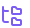Project structure

```text
prokat-hub/
├── client/                    React web client (Vite, TypeScript, Tailwind, shadcn/ui)
│   ├── public/                Logo and favicon
│   └── src/
│       ├── api/               HTTP client and Orval-generated API hooks
│       ├── auth/              Sign-in state and route guards
│       ├── components/        Shared UI, layout and booking components
│       ├── i18n/              English and Estonian translations
│       ├── pages/             Pages, including the dashboard (desk, catalogue, reports)
│       └── realtime/          SignalR live availability
├── server/
│   ├── ProkatHub.Api/         Web API: controllers, services, repositories, EF Core, Identity + JWT
│   ├── ProkatHub.Worker/      Hourly overdue worker that calls the API
│   └── ProkatHub.Tests/       xUnit tests
├── docs/                      Domain model, ER diagram, QA report, screenshots
├── http/                      Manual API tests (.http)
├── deploy/zone/               Deployment scripts for a Zone.ee server
├── .github/workflows/         CI
├── compose.yaml               Docker Compose: db, api, worker, web, tests
└── .env.example               Settings and secrets template
```

## 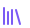More details

<details>
<summary><b>Logs</b></summary>

```bash
docker compose logs -f api
```

The API logs through [Serilog](https://serilog.net/). Requests to `/health`, Swagger and OpenAPI are logged at Debug level and hidden by default.

Levels and the output format are in the `Serilog` section of `appsettings.json`. Override them with environment variables in `compose.yaml`.

</details>

<details>
<summary><b>Overdue worker</b></summary>

`ProkatHub.Worker` runs once at startup and then every hour (`WORKER_INTERVAL` in `.env`). Each run it:

1. logs in as the Service account,
2. calls `GET /api/rentals/overdue`,
3. calls `POST /api/rentals/{id}/mark-late` for each rental,
4. writes a summary line to the log.

```bash
docker compose logs -f worker
```

The worker only talks to the API over HTTP and has no database access.

</details>

<details>
<summary><b>Development without Docker</b></summary>

The API and the client can also run on the host, with the database in Docker. This needs the .NET 10 SDK, and Node.js 22.12+ with pnpm.

```bash
docker compose up -d db
cd server/ProkatHub.Api
dotnet user-secrets set "ConnectionStrings:Default" "Server=localhost;Port=3306;Database=prokathub;User=prokathub;Password=<DB_PASSWORD>"
dotnet user-secrets set "Jwt:SigningKey" "$(openssl rand -base64 48)"
dotnet user-secrets set "Seed:Accounts:Customer:Password" "Customer12345"
dotnet run
```

```bash
cd client
cp .env.example .env.local
pnpm install
pnpm dev
```

Run the tests with `dotnet test server/ProkatHub.slnx`. To run the worker against a running API:

```bash
cd server/ProkatHub.Worker
dotnet user-secrets set "Api:Password" "<SEED_SERVICE_PASSWORD>"
dotnet run
```

Add an EF Core migration with:

```bash
cd server
dotnet tool restore
dotnet ef migrations add <Name> --project ProkatHub.Api --output-dir Data/Migrations
```

After changing the API's endpoints, regenerate the client's API code with `pnpm generate:api` in `client/`. See [client/README.md](client/README.md) for the client's scripts.

</details>

<details>
<summary><b>Deployment (Zone.ee)</b></summary>

The live site runs on a Zone.ee virtual server, which has no Docker, under `/prokathub` of the account's website:

- The **API** and the **worker** are self-contained `linux-x64` builds that PM2 keeps running.
- The API also serves the production build of the **web client** from its `wwwroot`, so the site and the API share one origin.
- The `PathBase` setting tells the API that requests arrive under `/prokathub`.
- Apache forwards `/prokathub` to the API with an `.htaccess` proxy rule.
- The **database** is the account's MariaDB from MyZone. The API applies migrations on startup.

```bash
cp deploy/zone/zone.env.example deploy/zone/zone.env   # once: server, paths, port, database name and user
deploy/zone/deploy.sh                                 # build, upload, write the proxy rule and PM2 files, (re)start
```

The first run writes `~/prokathub/api.pm2.json` and `worker.pm2.json` on the server, with a generated JWT key and seed account passwords. These secrets stay on the server only. Then:

```bash
deploy/zone/set-db-password.sh   # asks for the MyZone database password and stores it on the server
deploy/zone/deploy.sh            # starts both apps
```

Register both PM2 files in MyZone (PM2 rakendused), so Zone keeps the apps running after a server restart.

The app's settings are in the `env` of those PM2 files on the server. Nested settings use `__` in place of `:`, for example `Seed__DemoData` or `Overdue__Interval`. To change them:

```bash
deploy/zone/edit-env.sh          # API settings: opens nano on the server, checks the JSON, reloads the app
deploy/zone/edit-env.sh worker   # worker settings
deploy/zone/db-query.sh "SELECT Email FROM AspNetUsers"   # SQL against the live database
```
</details>

<details>
<summary><b>Continuous integration</b></summary>

[`.github/workflows/ci.yml`](.github/workflows/ci.yml) runs on every push and on pull requests to `main`:

| Job | What it checks |
| --- | --- |
| Server | `dotnet build` and `dotnet test` for `server/ProkatHub.slnx` (Release) |
| Client | `pnpm install --frozen-lockfile`, `pnpm lint`, `pnpm format:check`, `pnpm build` |
| Docker images | `docker compose build` for the dev images, plus the production API and web images |

</details>

**Further reading**

- [Domain model, ER diagram and business rules](docs/er-diagram.md)
- [Responsive and accessibility QA report](docs/qa-responsive-accessibility.md)
- [Web client README](client/README.md)

## License

Prokat Hub is licensed under the [GNU Affero General Public License v3.0](LICENSE).
