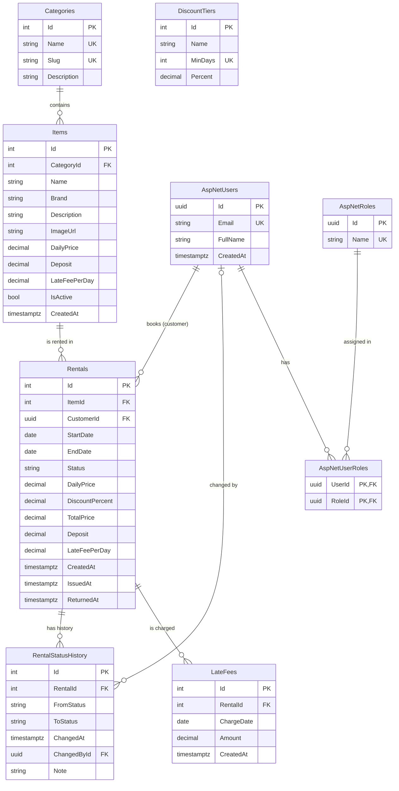
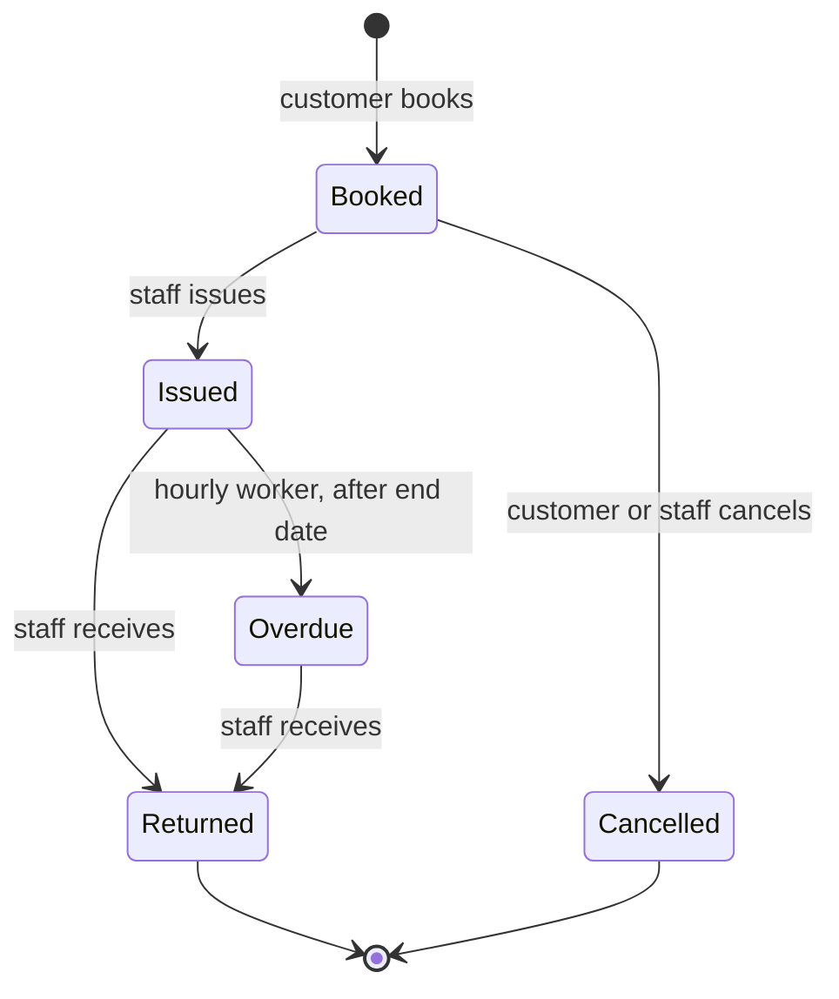

# Domain model

Prokat Hub rents out **electronics**. Every `Item` is one physical unit (one specific camera, drone or laptop), so two rentals of the same item must never overlap.

## ER diagram

`AspNetUsers`, `AspNetRoles` and `AspNetUserRoles` come from ASP.NET Core Identity; the other Identity tables (claims, logins, tokens) are left out of the diagram.

### Constraints and indexes

| Table | Rule |
| --- | --- |
| `Categories` | `Name` and `Slug` are unique |
| `Items` | `DailyPrice > 0`, `Deposit >= 0`, `LateFeePerDay >= 0` |
| `Rentals` | `EndDate >= StartDate`; index on `(ItemId, StartDate, EndDate)` for overlap checks |
| `LateFees` | unique `(RentalId, ChargeDate)`, so a day is never charged twice |
| `DiscountTiers` | `MinDays` is unique and `>= 1`; `Percent` is between 0 and 100 |
| all money columns | `numeric(10,2)`; `DiscountTiers.Percent` is `numeric(5,2)` |

Deleting a category or item that has rentals is blocked (`RESTRICT`). Items are retired with `IsActive = false` instead.

## Roles

| Role | What it can do |
| --- | --- |
| **Customer** | Browse the catalogue, book items, see own rentals |
| **Staff** | Issue and receive items, see overdue rentals |
| **Admin** | Everything Staff can do, plus catalogue edits and reports |
| **Service** | Account used by the Worker Service to find and mark overdue rentals |

Anyone can browse the catalogue without logging in.

## Rental statuses

| Status | Meaning |
| --- | --- |
| `Booked` | Reserved for the dates, item not picked up yet |
| `Issued` | Customer has the item |
| `Overdue` | Issued and the end date has passed without a return |
| `Returned` | Item is back; the rental is closed |
| `Cancelled` | Booking cancelled before pickup |

Any other transition is rejected. Every change is written to `RentalStatusHistory` with who made it and when.

`Booked`, `Issued` and `Overdue` rentals **block** the item; `Returned` and `Cancelled` do not. An overdue item stays unavailable until it is returned.

## Dates

- `StartDate` and `EndDate` are calendar dates and both are **inclusive**: 3 → 5 March is 3 rental days.
- Two rentals of the same item overlap when `a.StartDate <= b.EndDate AND b.StartDate <= a.EndDate`. A new booking that overlaps an active one is rejected with **409 Conflict**.
- A booking cannot start in the past.

## Pricing rules

1. **Rental days** = `EndDate − StartDate + 1`.
2. **Subtotal** = item `DailyPrice` × rental days.
3. **Discount**: the largest `DiscountTiers.Percent` whose `MinDays` is reached by the rental length. Seed tiers:

   | Rental length | Discount |
   | --- | --- |
   | 1–2 days | 0 % |
   | 3+ days | 10 % |
   | 7+ days | 20 % |
   | 14+ days | 30 % |

4. **Total price** = subtotal − discount, rounded to cents (midpoint away from zero).
5. **Deposit**: a fixed amount per item, taken at pickup and refunded on return. It is not part of the total price and gets no discount.
6. Price, discount, deposit and late fee are **copied onto the rental** when it is booked, so later catalogue changes do not change existing rentals.

## Late fees

- An `Issued` rental becomes `Overdue` once the current date is after `EndDate`.
- Each late day costs the item's `LateFeePerDay` (seeded as 150 % of the daily price).
- The hourly worker charges every late day once: one `LateFees` row per rental per day, from `EndDate + 1` up to today. The unique `(RentalId, ChargeDate)` index makes re-running it safe.
- Total late fee = sum of the rental's `LateFees` rows; it is settled when the item is returned.
